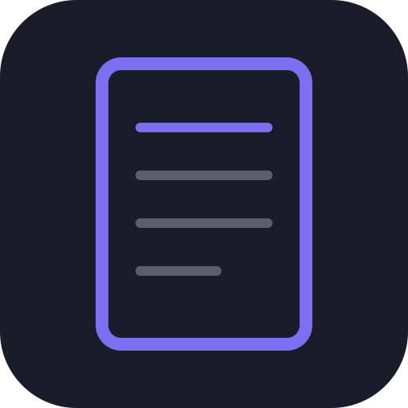
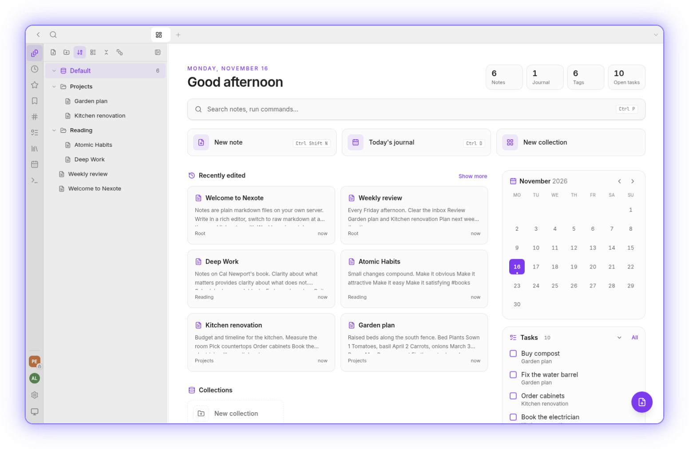

<div align="center">



# Nexote

A self-hosted, mobile-first markdown editor, heavily influenced by Obsidian.

[](https://github.com/2TAP2B/nexote/releases/latest)
[](LICENSE)
[](https://2tap2b.github.io/nexote/)
[](https://go.dev/)
[](https://nextjs.org/)

</div>

## What it is

Nexote runs on your own server and keeps your notes as plain markdown files with YAML frontmatter. There is no database: a note is a `.md` file named after its title, in a folder of a vault, and you can read, back up or move it with any tool. A small Go backend serves the files; a Next.js frontend with a Milkdown editor provides a desktop interface and a touch-first interface for phones and tablets, chosen per device. Several people can share one server, sign in with passkeys and work together in shared spaces.

<p align="center">
  
</p>

More screenshots, including the phone app, are in the [documentation](https://2tap2b.github.io/nexote/).

## Features

**Editor**
- Rendered and raw markdown views, with a per-device default.
- `[[Title]]` and `[[Title|label]]` wikilinks shown as clickable chips; a missing note is created on click.
- Obsidian/GitHub callouts (`> [!info]`) as colored boxes and `==highlights==`, stored as plain, portable markdown (optional).
- Formatting toolbar on desktop and above the keyboard on phones.
- Note picker on `@` or `[[`, slash menu, and a date insert with a configurable format.
- Block selection mode to copy, cut or delete whole blocks on touchscreens.
- Inline `#tags`, `- [ ]` tasks collected across vaults, and a full history of every note with restore.
- Daily journal, command palette with full-text search, tabs, bookmarks, table of contents, color schemes.
- Note tree with card view (previews), sort by name, last edited or created, note counts, and a tree that follows the open note.

**Mobile and tablet app**
- Touch interface for phones and tablets at the same address as the desktop one, chosen per device (switchable in Settings › General).
- Four swipeable panes: spaces, note tree, note, and table of contents or quick notes.
- Bottom pill navigation, bottom sheets, a toolbar above the keyboard, chrome that hides while scrolling, haptic feedback.

**Quick notes**
- Messenger-style Notepad for short memos, with images and `@` note links.
- Select memos to edit, copy, delete (with undo), turn them into a note or add them to a thread.
- Swipe a memo left to turn it into a thread: replies over days, `#tags`, a Threads view on desktop and phone, and a thread panel next to the note on desktop.
- Voice memos, transcribed by your OpenAI-compatible endpoint.
- The Notepad is private by default or lives in a vault of your choice.

**Collections**
- Typed sets of notes with text, number, yes/no and date fields, shown as a cover gallery.
- Built-in Books and Vinyls collections.
- Lookups from Google Books, Open Library, the Deutsche Nationalbibliothek and Discogs, with an ISBN barcode scanner.

**Spaces and accounts**
- Passkey-only sign-in, no passwords.
- Admin-created invite links (7 days) and recovery links (24 hours).
- Shared spaces with owner, editor and viewer roles; private by default.

**Sync and offline**
- Live updates in every open tab over server-sent events.
- Installable PWA that works offline: edit, create and delete notes without a connection; changes sync in order on reconnect, and a conflicting offline edit is kept as a copy instead of being lost.
- Optional git sync of the whole data directory, with push and pull to a remote.

**AI**
- Any OpenAI-compatible endpoint: rewrite, change tone, translate, custom prompts, note titles.
- Requests go through the backend; the connection is configured per device.

## Quick start

Nexote ships as one container image for `linux/amd64` and `linux/arm64`: `ghcr.io/2tap2b/nexote`.

```bash
git clone https://github.com/2TAP2B/nexote.git
cd nexote
echo "NEXOTE_PUBLIC_URL=https://notes.example.com" > .env
docker compose pull
docker compose up -d
```

`NEXOTE_PUBLIC_URL` must be the address people open in the browser. Sign-in uses passkeys, which browsers only allow over https on a domain name (or on `localhost`), so put a reverse proxy with TLS in front of port 3000. Without `.env` the URL defaults to `http://localhost:3000`, which is enough to try Nexote on the same machine.

On first start the server prints a setup code:

```bash
docker compose logs nexote
# No account exists yet. Open https://notes.example.com and create the admin account with the setup code: XXXX-XXXX
```

Open the URL, enter the code, choose a username and create a passkey. This first account is the admin.

To update: `docker compose pull && docker compose up -d`. To pin a release, set `NEXOTE_TAG=0.1.0` in `.env`. Lost all passkeys: `docker exec nexote nexote-backend recover <username>` prints a one-time recovery link.

See [Getting started](https://2tap2b.github.io/nexote/guide/getting-started) and [Configuration](https://2tap2b.github.io/nexote/guide/configuration) for reverse proxy notes, building from source and all environment variables.

## Development

The repository has a Nix flake with Go 1.25, Node.js 22, pnpm and the language servers. With [direnv](https://direnv.net/):

```bash
direnv allow        # or: nix develop
```

Backend (from `backend/`):

```bash
go build ./... && go vet ./... && go test ./...
go run .                       # serves :8080 (NEXOTE_PORT); prints the setup code while no account exists
go run . recover <username>    # one-time link that adds a passkey to an account
```

Frontend (from `frontend/`):

```bash
pnpm install                   # first time
pnpm typecheck                 # tsc --noEmit
pnpm dev                       # Next.js on :3000, proxies /api/* to the backend
```

Both at once, from the repository root, then open http://localhost:3000:

```bash
(cd backend && go run .) & (cd frontend && pnpm dev) & wait
```

[AGENTS.md](AGENTS.md) is a file index and map of the code base. The [development guide](https://2tap2b.github.io/nexote/reference/development) describes the architecture.

## Documentation

Full documentation: https://2tap2b.github.io/nexote/

## License

Nexote is licensed under the [GNU Affero General Public License v3.0](LICENSE).
